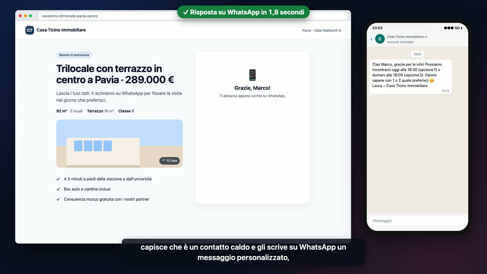
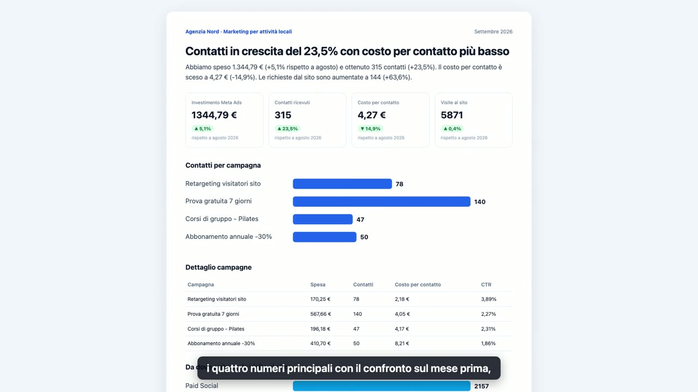

# Automazioni n8n per agenzie di marketing

Quattro automazioni costruite con [n8n](https://n8n.io), pensate per essere rivendute dalle agenzie ai loro clienti, anche in white label.
Ognuna ha un video di uno o due minuti che mostra il prima e il dopo.

**▶ Guarda le demo: [ebrahimabdelwahed.github.io/n8n-agency-demos](https://ebrahimabdelwahed.github.io/n8n-agency-demos/)**

| | Demo | Per chi | Cosa risolve |
|---|---|---|---|
| [](docs/video/01-lead-in-60-secondi.mp4) | **[1 · Il lead che riceve risposta in 60 secondi](demos/01-lead-in-60-secondi)** | Agenzie immobiliari, e chiunque raccolga contatti dalle campagne | Chi compila il modulo della campagna riceve subito un WhatsApp personalizzato. L'agente viene avvisato solo per i contatti caldi. |
| [](docs/video/02-report-mensile.mp4) | **[2 · Il report mensile che si scrive da solo](demos/02-report-mensile)** | Tutte le agenzie con clienti in gestione Ads | Il primo del mese il report è pronto: dati Meta Ads e Google Analytics, grafici e un commento in italiano semplice. |
| [](docs/video/03-recensioni-google.mp4) | **[3 · Recensioni Google sotto controllo](demos/03-recensioni-google)** | Ristoranti, hotel, negozi, studi professionali | Le recensioni positive ricevono una risposta personale, nel tono del locale. Quelle negative arrivano al titolare con una bozza pronta. |
| [](docs/video/04-prenotazioni-telefoniche.mp4) | **[4 · Il telefono che prende le prenotazioni](demos/04-prenotazioni-telefoniche)** | Ristoranti, pizzerie, agriturismi | Un centralino con l'AI risponde a ogni chiamata, rispetta le serate al completo e manda il WhatsApp al cliente. Il gestore accetta o rifiuta con uno swipe. |

## Perché queste quattro

- **Si vendono da sole al cliente finale**: ognuna sposta un numero che il titolare capisce (contatti che diventano appuntamenti, ore risparmiate, stelle su Google, tavoli pieni).
- **Sono white label**: tutto ciò che riguarda il cliente (nome, firma, tono di voce, orari, canali) sta in un unico blocco di configurazione. Per un nuovo cliente si duplica il workflow e si cambia quel blocco.
- **Restano in mano all'agenzia**: girano su n8n, lo standard di mercato, self-hosted o su n8n Cloud. Niente piattaforme chiuse.

## Come sono fatte

```
 modulo / orario / chiamata ──▶ n8n ──▶ AI ──▶ WhatsApp · Slack · Google · CRM · notifiche
```

- **n8n 2.x** per i flussi, con le Data Table di n8n come CRM leggero.
- **Un modello linguistico** per scrivere in italiano naturale: qualificare un lead, commentare i numeri del mese, rispondere a una recensione, ricavare una prenotazione dalla trascrizione di una telefonata. L'output è strutturato (JSON con schema), quindi il flusso decide in base a campi precisi e non a testo libero. Il modello si sceglie in base al cliente, anche con server nell'UE.
- **Nei video** i servizi esterni (WhatsApp, Slack, Meta, Google, centralino) sono simulati con lo stesso formato delle API vere, e i dati sono di esempio: nomi inventati, numeri di telefono non assegnati, metriche generate.

## Portarle in produzione

| Demo | Servizi da collegare |
|---|---|
| 1 | Meta Lead Ads o modulo del sito, WhatsApp Cloud API, Slack, CRM a scelta (Data Table, Google Sheets, HubSpot) |
| 2 | Meta Marketing API, Google Analytics 4 Data API, Google Drive o e-mail per il PDF, Slack |
| 3 | Google Business Profile API, Slack (o e-mail / WhatsApp per il titolare) |
| 4 | Centralino vocale (Vapi, Retell o ElevenLabs Agents) con numero italiano, WhatsApp Cloud API con template, ntfy o bot Telegram per il gestore |

I workflow non sono pubblici: li installo e li personalizzo io sull'istanza n8n dell'agenzia o del cliente.

## Contatti

Realizzato da **Ebrahim Abdelwahed**.
Se lavori in un'agenzia e vuoi una di queste automazioni per i tuoi clienti, scrivimi: **[ebrahim06abdelwahed@gmail.com](mailto:ebrahim06abdelwahed@gmail.com?subject=Automazioni%20n8n%20per%20i%20nostri%20clienti)**

Preventivo su misura: setup una tantum più manutenzione mensile.

© 2026 Ebrahim Abdelwahed. Tutti i diritti riservati.
