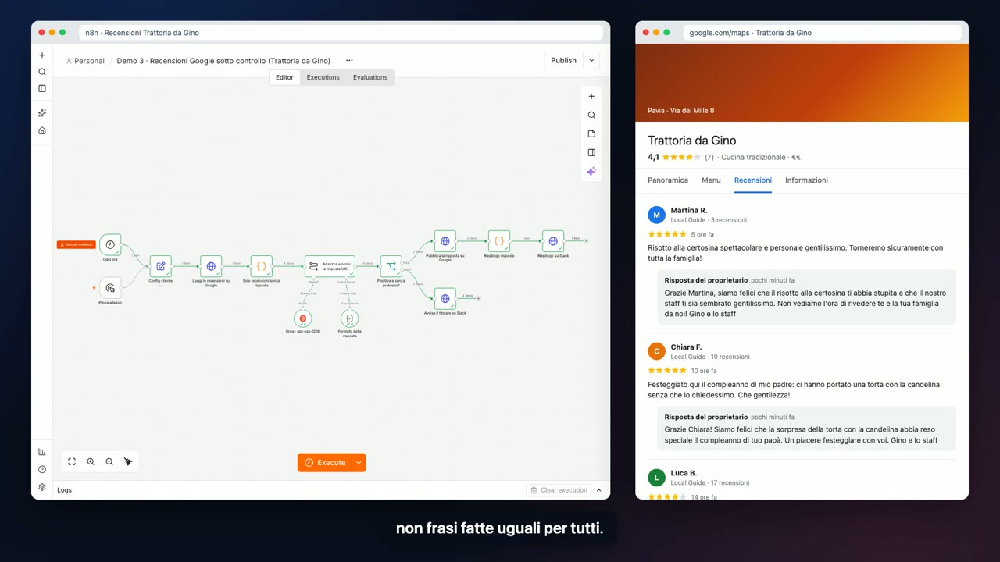

# Demo 3 · Recensioni Google sotto controllo

[](../../docs/video/03-recensioni-google.mp4)

▶ [Guarda il video (1 min 12 s)](../../docs/video/03-recensioni-google.mp4)

## Il problema

Le recensioni senza risposta pesano sulla scheda Google e sulla decisione di chi sta scegliendo dove andare. Il titolare non ha tempo di rispondere a tutte, e quando lo fa usa la stessa frase per tutti. Le recensioni negative restano lì giorni senza che nessuno se ne accorga.

## Cosa fa

1. **Ogni ora** legge le recensioni nuove sul profilo Google dell'attività.
2. L'AI analizza ogni recensione (sentimento, temi, se serve attenzione) e scrive una risposta **personale, nel tono di voce del locale**, che cita i dettagli della recensione.
3. Le recensioni positive e senza problemi ricevono **la risposta pubblicata in automatico**, con la firma del locale.
4. Le recensioni negative, o positive ma con una critica, **non vengono toccate**: il titolare riceve su Slack la recensione, una nota su cosa è successo e una bozza di risposta da copiare o modificare.
5. A fine giro arriva su Slack un riepilogo delle risposte pubblicate.

## Il flusso

```
Ogni ora   (oppure: Prova adesso)
  → Config cliente                      nome, tono di voce, firma, soglia di stelle, profilo Google
  → Leggi le recensioni su Google
  → Solo recensioni senza risposta
  → Analizza e scrivi la risposta (AI)
        └ Groq · gpt-oss-120b + Formato della risposta (sentimento, temi, serve attenzione, risposta, nota per il titolare)
  → Positiva e senza problemi?
        ├ sì → Pubblica la risposta su Google → Riepilogo risposte → Riepilogo su Slack
        └ no → Avvisa il titolare su Slack (con la bozza)
```

## Personalizzarlo per un nuovo cliente

Nel nodo **Config cliente**:

| Campo | Esempio |
|---|---|
| `tono_di_voce` | "familiare e caloroso, con un pizzico di ironia pavese; mai servile" |
| `firma` | Gino e lo staff |
| `soglia_risposta_automatica` | 4 → si risponde da soli solo a 4 e 5 stelle senza problemi |
| `gbp_account`, `gbp_location` | identificativi del profilo Google Business |
| `slack_webhook` | canale del titolare (o e-mail / WhatsApp al posto di Slack) |

## In produzione

- **Google Business Profile**: `gbp_api` diventa `https://mybusiness.googleapis.com/v4`, con una credenziale OAuth Google in n8n. L'accesso all'API va richiesto a Google una volta per l'agenzia, poi vale per tutti i profili che gestisce.
- **Controllo umano**: per i primi giorni si può alzare la soglia a 5 stelle, oppure mandare in approvazione anche le positive.
