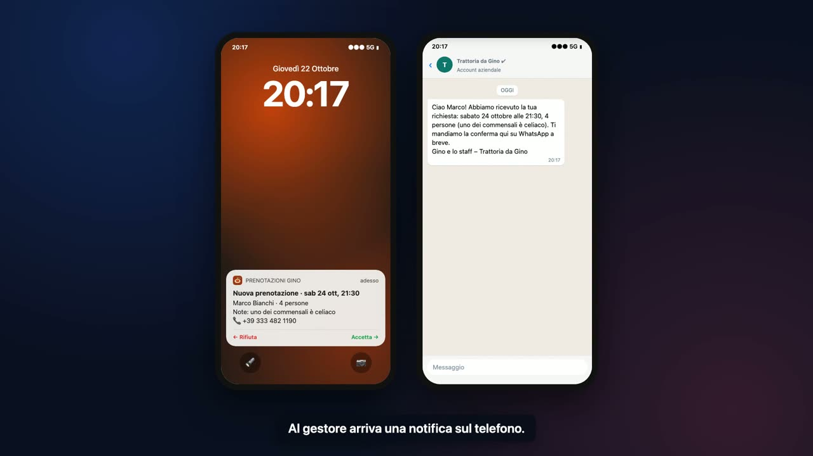

# Demo 4 · Il telefono che prende le prenotazioni

[](../../docs/video/04-prenotazioni-telefoniche.mp4)

▶ [Guarda il video (2 min 15 s)](../../docs/video/04-prenotazioni-telefoniche.mp4)

## Il problema

Durante il servizio nessuno ha tempo di rispondere al telefono. Ogni chiamata persa è un tavolo che resta vuoto, e chi risponde di corsa sbaglia orari, dimentica le note (allergie, seggiolone, compleanni) o promette posti in una serata già piena.

## Cosa fa

1. **Un centralino vocale con l'AI** risponde al numero del ristorante, a qualsiasi ora, e parla con il cliente in italiano.
2. **Durante la chiamata** il centralino chiede a n8n se c'è posto. n8n controlla la tabella delle **serate al completo** che il gestore aggiorna quando vuole (feste private, sala piena, chiusure). Se l'orario è pieno, propone subito i due turni liberi più vicini.
3. **A fine chiamata** l'AI legge la trascrizione e ricava la prenotazione: nome, data, ora, persone, note. Ricontrolla la disponibilità e salva la richiesta in tabella come *in attesa*.
4. Il cliente riceve **subito un WhatsApp**: "abbiamo ricevuto la tua richiesta, ti mandiamo la conferma a breve".
5. Sul telefono del gestore arriva una **notifica**: uno swipe a destra per accettare, a sinistra per rifiutare.
6. Appena il gestore decide, il cliente riceve **il WhatsApp di conferma** (o un messaggio gentile se non c'è posto) e la tabella si aggiorna.

Se il cliente insiste su un orario al completo, non parte nessuna notifica: riceve direttamente un WhatsApp con gli orari liberi.

## Il flusso

```
Chiamata dal centralino AI   (webhook, chiamato dal centralino vocale)
  → Config ristorante                    nome, città, firma, turni, canali
  → Il centralino chiede se c'è posto?
        ├ sì (durante la chiamata)
        │    → Leggi le serate al completo → Controlla le fasce al completo → Rispondi al centralino
        └ no (fine chiamata, arriva la trascrizione)
             → Conferma la ricezione
             → Estrai la prenotazione (AI)
                   └ Groq · gpt-oss-120b + Formato della prenotazione (nome, data, ora, persone, note, riepilogo)
             → È una prenotazione? → Dati della prenotazione → Ricontrolla la disponibilità
             → C'è ancora posto?
                   ├ no → WhatsApp: siamo al completo (con gli orari liberi)
                   └ sì → Salva la richiesta (in attesa) → WhatsApp: richiesta ricevuta
                          → Notifica al gestore (con i pulsanti Accetta / Rifiuta)
                          → Aspetta lo swipe del gestore
                          → Accettata?
                                ├ sì → Segna come confermata → WhatsApp: prenotazione confermata
                                └ no → Segna come rifiutata  → WhatsApp: non riusciamo
```

Il workflow usa due Data Table di n8n:

| Tabella | Chi la scrive | Colonne |
|---|---|---|
| **Serate al completo** | il gestore, a mano (o da un modulo) | `data`, `dalle`, `alle`, `motivo` |
| **Prenotazioni** | il workflow | `nome`, `telefono`, `data`, `ora`, `persone`, `note`, `stato`, `riepilogo`, `chiamata_id` |

## Personalizzarlo per un nuovo ristorante

Nel nodo **Config ristorante**:

| Campo | Esempio |
|---|---|
| `ristorante`, `citta`, `telefono_ristorante` | Trattoria da Gino, Pavia, 0382 000000 |
| `firma` | Gino e lo staff |
| `turni` | `["19:30", "20:00", "20:30", "21:00", "21:30", "22:00"]`: gli orari che il centralino può proporre |
| `max_persone_senza_conferma_telefonica` | 10: sopra questa soglia la risposta al centralino segnala un gruppo numeroso, così l'assistente può avvisare che il gestore lo valuterà |
| `whatsapp_api`, `whatsapp_phone_number_id` | numero WhatsApp Business del ristorante |
| `push_api`, `push_topic` | dove arriva la notifica al gestore |

Le istruzioni del centralino (saluto, tono, cosa chiedere) si scrivono nel prompt del centralino vocale, non in n8n.

## In produzione

- **Centralino vocale**: [Vapi](https://vapi.ai), [Retell](https://www.retellai.com) o [ElevenLabs Agents](https://elevenlabs.io/conversational-ai), con un numero italiano inoltrato dal numero del ristorante (anche solo quando la linea è occupata o fuori orario). Si configurano due cose:
  - un **tool** `verifica_disponibilita` (parametri `data`, `ora`, `persone`) che chiama il webhook di n8n durante la chiamata;
  - il **webhook di fine chiamata** verso lo stesso indirizzo, che manda la trascrizione.
  Il simulato usa il formato `{event, call_id, from_number, args}` e `{event: "call_ended", call: {transcript, ...}}`: con il provider scelto basta adattare il nodo *Il centralino chiede se c'è posto?* e i campi letti da *Estrai la prenotazione*.
- **Notifica al gestore**: [ntfy](https://ntfy.sh) (app gratuita, i pulsanti della notifica chiamano direttamente n8n) oppure un bot Telegram con due pulsanti. Gli indirizzi dei pulsanti sono firmati da n8n, quindi nessuno può accettare una prenotazione al posto del gestore.
- **WhatsApp Cloud API**: fuori dalla finestra di 24 ore servono messaggi template approvati da Meta (richiesta ricevuta, conferma, rifiuto). `whatsapp_api` diventa `https://graph.facebook.com/v21.0`, con una credenziale Bearer in n8n.
- **Se il gestore non risponde**: al nodo *Aspetta lo swipe del gestore* si può aggiungere un limite di tempo (per esempio 30 minuti) e un ramo che manda un promemoria, o che chiama il cliente.
- **Tavoli e coperti**: per gestire i coperti reali basta sostituire la tabella delle serate al completo con il gestionale del ristorante (TheFork Manager, Plateform, un Google Sheet) nel nodo *Leggi le serate al completo*.
